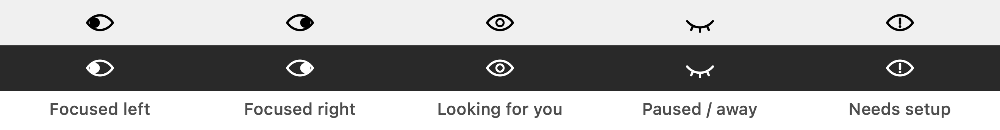
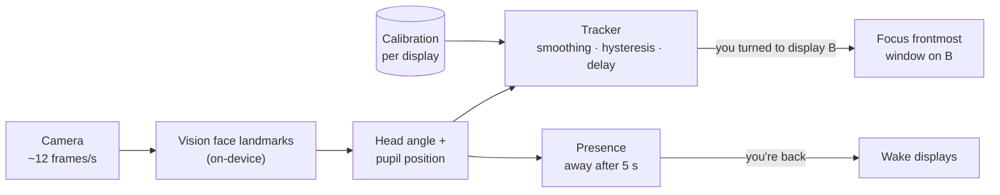

<h1 align="center">Glance</h1>

<p align="center"><b>Look at a screen. It gets focus.</b></p>

<p align="center">
  <a href="https://github.com/avadheshnewdelhi/glance/releases/latest"></a>
  <a href="https://github.com/avadheshnewdelhi/glance/actions/workflows/ci.yml"></a>
  
  
  
  <a href="LICENSE"></a>
</p>

You turn to your external monitor and start typing, and the text goes into a window on your laptop screen, because focus stayed where you last clicked.

**Glance** is a tiny macOS menu bar app that fixes that. It uses your Mac's camera to see which display you're facing and gives that display keyboard focus. Turn right, and the window on your right monitor is ready for typing. Turn back, and focus comes with you.

Everything runs on your Mac. Glance has no network access at all, and macOS enforces that, not just a promise.

<p align="center"></p>

## Features

- **Focus follows your gaze.** Turn toward a display and its frontmost window gets keyboard focus. Optionally, the pointer jumps there too, so scrolling works straight away.
- **Instant by default.** Focus switches about two camera frames (~0.17 s) after you turn. Hysteresis stops it flickering when you look near the edge between two screens. Prefer a pause first? Choose 0.2, 0.4 or 0.8 s.
- **Knows when you've left.** If no one is in view for 5 seconds, switching pauses. It resumes the moment you sit back down.
- **Wakes your displays when you return** (optional). If the screens went to sleep while you were away, they turn on as soon as the camera sees you.
- **Any arrangement.** Left, right, or several displays side by side. A 10-second calibration learns where each screen is for you.
- **An icon that glances back.** The eye in the menu bar looks toward the display that has focus.
- **Private by design.** Camera frames are analysed in memory and thrown away. No network, no recordings, no screen recording permission.

## Install

### Homebrew (recommended)

```sh
brew install --cask avadheshnewdelhi/tap/glance
```

Homebrew verifies the download's checksum and installs Glance ready to open, without the "Open Anyway" step below. The cask lives in [avadheshnewdelhi/homebrew-tap](https://github.com/avadheshnewdelhi/homebrew-tap).

### Download

1. Download **[Glance.dmg](https://github.com/avadheshnewdelhi/glance/releases/latest/download/Glance.dmg)** from the [latest release](https://github.com/avadheshnewdelhi/glance/releases/latest).
2. Open the DMG and drag **Glance** into **Applications**.
3. Open Glance. The first time, macOS will say it can't verify the developer, because Glance is a free open-source app that isn't notarized by Apple. To allow it:
   - open **System Settings › Privacy & Security**, scroll down and click **Open Anyway** next to the Glance message; **or**
   - in Terminal, run `xattr -dr com.apple.quarantine /Applications/Glance.app`.

Prefer to check before running it? The release notes list the DMG's SHA-256 checksum. You can also build the same app yourself from source (below).

### Update and uninstall

| | Homebrew | Manual install |
|---|---|---|
| **Update** | `brew upgrade --cask glance` | Download the latest `Glance.dmg` and replace the app in Applications |
| **Uninstall** | `brew uninstall --cask glance` | Quit Glance, then drag it from Applications to the Bin |
| **Also remove calibration and settings** | `brew uninstall --zap --cask glance` | Delete `~/Library/Containers/local.glance` |

Glance never checks for updates itself, because it has no network access. Watch or star this repo to hear about new releases. Each new version has a new signature, so macOS asks for camera access again after an update.

### Build from source

Needs macOS 14 or later and Xcode 15 or later (or a Swift 5.10+ toolchain).

```sh
git clone https://github.com/avadheshnewdelhi/glance.git
cd glance
./build.sh             # builds and signs build/Glance.app
open build/Glance.app
```

`./package.sh` builds the same DMG that's published on the releases page.

## Getting started

1. **Allow camera access** when macOS asks.
2. **Calibrate.** A dot appears on each display in turn. Look at it the way you normally look at that screen, for about two seconds each.
3. **Work normally.** Turn toward a screen and it gets focus. The menu shows which display Glance thinks you're on.

Tip: **turn your head, at least a little.** A webcam can see a head turn much more reliably than eyes moving alone. If two displays look too similar during calibration, Glance will ask you to turn a bit more.

Recalibrate from the menu whenever you move a monitor or your chair. If you plug in a different set of displays, Glance asks you to calibrate for them.

## The menu

| Item | What it does |
|---|---|
| **Pause / Resume Tracking** | Turns the camera off or back on. |
| **Recalibrate…** | Re-learns where your displays are. |
| **Switch Delay** | Instant (default), 0.2 s, 0.4 s or 0.8 s. How long you must face a display before it gets focus. |
| **Move Pointer With Focus** | Moves the mouse pointer to the newly focused window. |
| **Wake Displays When I Return** | Keeps the camera on while the displays sleep, so it can wake them when you're back. |
| **Raise Exact Window** | Optional, needs Accessibility. Raises the exact window rather than just its app. Useful when one app has windows on several displays. |

## Privacy

Glance needs a camera to work, so it's built to deserve that trust.

- **No network access, enforced by macOS.** Glance runs in Apple's App Sandbox *without* the network entitlement, so the operating system blocks every connection it might try. Check it yourself:
  ```sh
  codesign -d --entitlements - /Applications/Glance.app
  ```
  The only entitlements are `app-sandbox` and `device.camera`.
- **Frames never leave memory.** Each frame goes through Apple's on-device [Vision](https://developer.apple.com/documentation/vision) face landmarks. Glance keeps two numbers from each frame, the head angle and the pupil position, and drops the frame. Nothing is recorded or written to disk except a few calibration numbers per display.
- **The camera is off when it isn't needed.** It stays off when you pause, with only one display connected, and when another user is logged in. It stays on while the screen is locked or asleep only if you enable **Wake Displays When I Return**.
- **Minimal window access.** To decide what to focus, Glance reads only which app owns each visible window and where the window is. It never reads titles or contents and doesn't need Screen Recording permission.
- **Accessibility is optional.** Without it, Glance focuses the right *app*. Grant it only if you want the exact window raised.

## How it works



1. **`GazeCamera`** analyses about 12 frames a second (4 while you're away). From each frame it takes your head yaw (left–right angle) and how far your pupils sit from the centre of your eyes.
2. **Calibration** records the typical values while you look at each display, and how much they wobble.
3. **`GazeTracker`** smooths the readings and picks the nearest display. It switches only when another display is clearly closer, and it acts only when your gaze *changes*, so it never fights you when you click into another screen yourself.
4. **`DisplayFocuser`** activates the app that owns the frontmost window on that display. If Accessibility is granted, it raises that exact window.
5. **`Presence`** marks you away after 5 seconds without a face, and back on the first frame that sees one.

## Limitations

- **Left and right only.** Glance can't tell apart displays stacked one above the other.
- **Head turns beat eye movements.** At webcam resolution, eyes moving alone give a weak signal. The more displays side by side, the smaller the turn between neighbours.
- **Any face counts.** Glance can't tell people apart. Someone else at your desk can steer focus, and a passer-by can count as you coming back.
- **Without Accessibility, focus is per app.** If one app has windows on two displays, the wrong one may come forward. Windows in other Spaces or behind full-screen apps aren't considered.
- **Light and camera position matter.** In dim light or with heavy glare on glasses, faces can be missed. Switching then pauses until you're found again.
- **The camera keeps the Mac awake.** While the camera runs, macOS won't sleep. That includes **Wake Displays When I Return** keeping it on while the screens are asleep.
- **With 4 or more displays, the icon is approximate.** The menu always names the focused display exactly.
- **Not notarized and no launch at login (yet).** A manual download needs a one-time "Open Anyway" step; Homebrew installs skip it (see [Install](#install)). Each new version has a new signature, so macOS asks for camera access again after an update.

## Development

```sh
swift test       # unit tests for the gaze, calibration and presence logic
./build.sh       # build/Glance.app (uses your Apple Development identity if you have one, otherwise ad hoc)
./package.sh     # build/Glance.dmg, ad hoc signed
scripts/release.sh   # publish: tag, GitHub release with the DMG, and update the Homebrew cask
```

To release, bump `CFBundleShortVersionString` in `Resources/Info.plist`, add a matching section to `CHANGELOG.md`, commit, then run `scripts/release.sh`.

Watch Glance's decisions live:

```sh
/usr/bin/log stream --predicate 'subsystem == "local.glance"'
# Glance focused DELL U2720Q because you looked there (yaw -0.84, pupil 0.02)
```

In zsh, plain `log` is a built-in shell command, so use the full path.

| Path | What's there |
|---|---|
| `Sources/GlanceCore` | Pure logic with no UI: calibration, the gaze tracker, presence |
| `Sources/Glance` | The app: camera and Vision, focusing, calibration overlay, menu, icon |
| `Tests/GlanceCoreTests` | Unit tests for `GlanceCore` |
| `scripts/release.sh` | Publishes a release and updates the [Homebrew tap](https://github.com/avadheshnewdelhi/homebrew-tap) |
| `scripts/make-icon.swift` | Draws the app icon and writes `Resources/AppIcon.icns` |
| `docs/TESTING.md` | What's tested automatically, what was verified by hand, and what hasn't been yet |

Issues and pull requests are welcome, especially reports from setups with three or more displays, external webcams, or the lid closed.

## License

[MIT](LICENSE)
